# WeChat Realtime Reader

A design draft for a read-only, near-realtime reader of local WeChat 4.x chat
history on macOS.

> The goal is to read messages that have already synced to this Mac and been
> committed to the SQLite WAL. It does not control the WeChat UI, does not send
> messages, does not modify WeChat's databases, and does not export chat history
> by default.

## Verified facts

- Environment: macOS, WeChat 4.2.0.16.
- Databases live under the official container's `xwechat_files/<account>/db_storage/`.
- The core chat databases are `contact/contact.db`, `session/session.db`, and
  `message/message_0.db` through `message/message_5.db`.
- Message databases use 4096-byte pages, an 80-byte reserve, AES-256-CBC, and
  HMAC-SHA512.
- 26 keys that pass the real database first-page check are stored on this Mac;
  every database needed for chat is covered.
- Verified: main-db + WAL merge, per-page HMAC, AES decryption, and SQLite
  integrity checks.
- In live testing, a new message modifies both `session.db` and the matching
  `message_N.db`, with refresh and body read-back completing in about 1.5 s.

## Key boundary

Real keys must never be placed in this project, in Git, in logs, or in chat
output. Current private storage location:

```text
~/.config/wechat-realtime-reader/
├── keys.json                 # paired database keys, 0600
├── image-key.json            # AES/XOR keys for image .dat, derived on first run, 0600
├── source-config.json        # data-source mapping, 0600
└── key-capture/
    └── wechat_frida_keys.log # raw capture record, 0600
```

At runtime only paired keys are loaded. Frida and a self-signed WeChat should not
be part of the day-to-day flow. Only when the database salt/key rotates and the
old key fails verification is "re-acquire the key" run, as a separate manual
maintenance procedure.

The key-acquisition instructions and companion tooling are in
[project Skills](SKILLS.md); the detailed entry point is
[wechat-db-keys](skills/wechat-db-keys/SKILL.md).

## Overall architecture

```mermaid
flowchart LR
    A[Official WeChat] -->|SQLite main db + WAL| B[File-change watcher]
    B --> C[Stable snapshot reader]
    C --> D[WAL validation & committed-frame replay]
    D --> E[Per-page HMAC verification]
    E --> F[AES-256-CBC decryption]
    F --> G[Private plaintext snapshot]
    G --> H[Read-only query layer]
    H --> I[Local API / Agent tool]
```



### 1. Data-source discovery

- The account directory must be bound by explicit configuration; it is not
  guessed from directory ordering or newest mtime.
- By default only `contact`, `session`, `message_0..N`, the necessary
  `biz_message_*`, plus `media_0..N` (which holds voice audio) and the avatar
  database `head_image` are watched.
- Moments, Favorites, and the search index are out of scope for the realtime
  chat MVP.

### 2. Change watching

Prefer FSEvents/kqueue to watch `.db`, `-wal`, and `-journal`, rather than
high-frequency full-directory scans.

- Debounce 200–500 ms after an event arrives.
- At most one refresh task runs per database at a time.
- Later events are coalesced into a single follow-up refresh after the current
  one finishes.
- File mtime is not taken as proof that a message is committed; the WAL commit
  frame must be checked.

### 3. Stable snapshots

A snapshot is built per database, independently:

1. Record the inode, size, and mtime/ctime of the main db and the WAL.
2. Read the main db and the WAL.
3. Read the metadata again; retry if it differs from before.
4. Reject a concurrent rollback journal; do not publish a snapshot that may be
   mid-transaction.
5. Validate the WAL magic, version, page size, generation salt, header checksum,
   and frame rolling checksum.
6. Replay only the last committed transaction; ignore uncommitted frames.

Consistency here is "single-database, commit-level"; it makes no claim of
atomicity across databases.

### 4. Authenticated decryption

For each page:

1. Take the salt from the first 16 bytes of the first page.
2. Derive the HMAC key from the database key and `salt XOR 0x3A`.
3. Verify HMAC-SHA512 over the encrypted payload and the little-endian page
   number.
4. Only after the HMAC passes, run AES-256-CBC decryption using the page-trailing
   IV.
5. Rebuild the SQLite first-page header, preserving reserve-byte semantics.

A failure on any page must fail the whole snapshot; it must not skip a corrupt
page or fall back to old data while pretending to be current.

### 5. Snapshot publishing

- Decrypt to a temp file in the same directory.
- Run `PRAGMA quick_check`; run a full `integrity_check` periodically.
- On success, replace the `current` snapshot with an atomic rename.
- On failure, keep the previous snapshot but mark it `stale` with the source's
  latest time; it must not be treated as a realtime result.
- Plaintext snapshots live only in a private, 700-permission local directory,
  with 600-permission files.

### 6. Query layer

The query layer opens only published, static plaintext snapshots, in SQLite
`immutable=1`/read-only mode.

Basic capabilities:

- Recent sessions, unread counts, and last message.
- Query messages by session ID + time range.
- Read only new messages after the last consumed position.
- Publish a parsed message as a local event for an agent or local panel to
  consume.

It returns structured JSON by default and does not auto-write Markdown/text
exports.

## Near-realtime semantics

"Realtime" means that once a message has been written to this Mac's WAL and
committed by WeChat, the system can read it within seconds. It does not include:

- Phone messages not yet synced to the computer.
- SQLite transactions not yet committed.
- Server-side data WeChat has not stored locally.
- Cases where the image/voice/video file itself has not been downloaded yet.

Each result should carry:

- `source_commit_time`: the source commit time the snapshot covers.
- `snapshot_time`: when the plaintext snapshot finished.
- `lag_ms`: the difference between the two.
- `fresh/stale/gap`: the freshness state.

## Usage

Requires Go 1.25+ and macOS. Keys and the data-source mapping live in
`~/.config/wechat-realtime-reader/` (see above).

```bash
go build -o bin/wechat-reader ./cmd/wechat-reader

bin/wechat-reader doctor        # verify keys per database (prints no key material)
bin/wechat-reader sync          # build/refresh the plaintext snapshots
bin/wechat-reader serve         # web viewer + HTTP MCP + realtime sync
bin/wechat-reader mcp           # stdio MCP (syncs itself if no other process is syncing)
bin/wechat-reader status        # per-database freshness
bin/wechat-reader token         # show the web / HTTP MCP access token
```

### Web viewer

`serve` listens on `127.0.0.1:5678` by default and prints a link with `?token=`
on startup; the first open writes an HttpOnly cookie.

- Left: the session list, searchable by name/remark/WeChat ID/pinyin, filterable
  by private chat / group / official account.
- In-session filters: sender (group-member dropdown, or click a name on a
  message), keyword, date range; the filter is written into the URL hash and can
  be bookmarked.
- Cross-session search: pick a contact and see their messages across all private
  chats and groups; keyword and date can be stacked on top.
- New messages are pushed to the page in realtime over SSE.
- Image messages show a thumbnail; click to see the original. Only images WeChat
  has already downloaded to this Mac can be shown: thumbnails almost always
  exist, originals only after the image has been opened inside WeChat.

### Images

Images live at `msg/attach/<md5(session)>/<year-month>/Img/<id>[_t|_h].dat`, with
`<id>` coming from the message's `packed_info_data`. The 4.x V2 format: after the
file header, the first 1024 bytes are AES-128-ECB, a trailing stretch is
single-byte XOR, and the middle is plaintext.

- AES key = `hex(md5(uin + wxid))[:16]`, XOR key = `uin & 0xff`. On first run it
  is brute-forced from one thumbnail (2^24 candidates, a few seconds) and written
  to `image-key.json`, without touching the WeChat process.
- Most originals are WeChat's own `wxgf` (HEVC) format, which browsers cannot
  display. With `ffmpeg` installed they are converted to JPEG and cached in the
  vault's `cache/img/` (a private directory); without it, it falls back to the
  thumbnail.

### MCP

stdio (local clients such as Claude Code):

```bash
claude mcp add wechat -- /path/to/bin/wechat-reader mcp
```

HTTP: `serve` also exposes Streamable HTTP at `http://127.0.0.1:5678/mcp`, which
requires `Authorization: Bearer <token>`.

| Tool | Purpose |
| --- | --- |
| `list_sessions` | Recent sessions, unread counts, last message |
| `search_contacts` | Find contacts, groups, official accounts by name/remark/WeChat ID/pinyin |
| `get_messages` | Read one session, filterable by sender, keyword, time; `before_seq` paginates |
| `search_messages` | Search across sessions by keyword and/or sender |
| `list_chat_members` | Who has spoken in a session and how many messages |
| `get_new_messages` | New messages after a cursor, for continuous tracking |
| `get_image` | Return an image message's image (thumbnail or original) for an agent to view directly; marked `THUMBNAIL ONLY` when the original is not downloaded |
| `get_video` | Return a video message's cover image and the local mp4 path |
| `get_voice` | Return a voice message's WeChat transcript, duration, and the decoded local WAV path; includes the audio when `audio=true` |
| `sync_status` | Snapshot freshness per database |

Session and sender parameters accept a username or a display name, with fuzzy
matching. Time parameters accept `2006-01-02`, `2006-01-02 15:04`, RFC3339, unix
seconds, and relative forms like `24h` or `7d`. Every result carries `freshness`
(`fresh`/`stale`, `lag_ms`).

Media notes:

- Image thumbnails and video covers are stored when the message is received;
  whether the original and the mp4 exist depends on whether WeChat has downloaded
  them (private chats mostly auto-download; group chats often only download after
  the item has been viewed inside WeChat).
- A voice message's WeChat transcript (automatic or manual speech-to-text) is
  stored in the message's `packed_info_data` and is appended directly into the
  message body, so it is keyword-searchable.
- Voice audio lives in the `VoiceInfo` table of `message/media_N.db` in SILK v3
  format, decoded to WAV on demand and cached in the vault's `cache/voice/`
  (0600).

At any moment only one process holds `state/sync.lock` and writes snapshots;
other processes (e.g. a second `mcp`) read that process's snapshots and
`manifest.json` read-only. After the lock holder exits, another process takes
over automatically.

## Project layout

```text
cmd/wechat-reader/        CLI: serve / mcp / sync / status / doctor / token
internal/config/          private config loading, permission checks, key-name mapping
internal/crypto/          per-page HMAC-SHA512 authentication + AES-256-CBC decryption
internal/wal/             WAL parsing: checksums, generation salt, committed transactions only
internal/snapshot/        stable reads, per-page tag deltas, clonefile + rename atomic publish, watching and manifest
internal/media/           image .dat decoding (V1/V2/legacy XOR), key derivation, wxgf→JPEG
internal/store/           read-only queries: contacts, sessions, message parsing (zstd, XML cards, quotes, system messages)
internal/mcpserver/       MCP tools
internal/web/             web UI (embedded), JSON API, SSE, token auth
```

### Incremental refresh

The 80 trailing bytes of each page (IV + HMAC) are preserved verbatim in the
plaintext snapshot's reserve area, serving as that page's tag:

1. When the main-db metadata is unchanged, only pages in the WAL and pages that
   last came from the WAL are examined; a full comparison happens only when the
   main db changes (checkpoint).
2. Only pages with a differing tag are decrypted; pages with the same tag are
   still HMAC-verified, so tampering is still caught.
3. The current snapshot is copied with APFS `clonefile`, only the changed pages
   are written, then an atomic `rename` swaps it in.
4. On restart, tags are read back directly from the published snapshot; no
   re-decryption is needed.

Measured: an initial full pass over 1.3 GB takes about 2.7 s (including
`quick_check`); refreshing a single new message touches only a few pages, about
20–40 ms.

## Tests that must be covered

- WAL endianness, checksums, generation switches, uncommitted frames, truncation,
  and growth.
- No mixed snapshot published when the main db/WAL changes mid-read.
- Wrong key/salt, page-ciphertext tampering, HMAC tampering, and wrong page
  numbers.
- The previous readable copy must not be overwritten when a snapshot fails.
- Multi-message fragments, empty tables, compressed bodies, revoked/system
  messages, and schema version changes.
- No log, exception, or manifest may contain a key, a full salt, a wxid, or raw
  chat body text.

Implemented tests: `go test ./...` covers WAL endianness/checksum/generation/
uncommitted-frame/truncation, page tampering/IV/HMAC/wrong-page-number/wrong-key,
and the full snapshot flow of full → no-change → WAL delta → checkpoint →
tamper-fails-without-overwriting → restart-reuses-tags (all fixtures are
synthetic data).

## Security rules

- The source WeChat directory is always read-only; no checkpoint, vacuum, attach,
  or pragma write operations.
- No re-signing, injecting, or modifying files of the official `WeChat.app`.
- Do not persistently keep raw PBKDF2 parameter logs; if kept manually, they must
  be in a private directory with 600 permissions.
- Do not place plaintext databases in Projects, Desktop, Downloads, iCloud/
  Dropbox, or any Git directory.
- The external API binds to loopback only (it refuses to start on a non-loopback
  address), enforces token authentication, and checks the Host header to prevent
  DNS rebinding.
